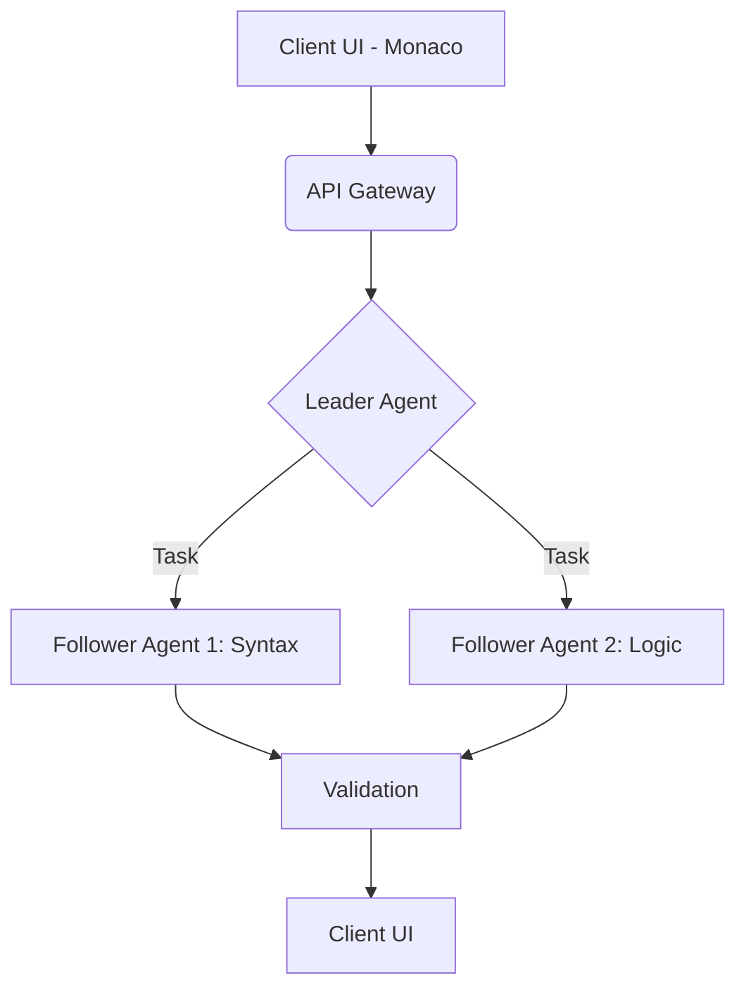

# CodeFlow: Agentic IDE Ecosystem

**TechForge Industrial**
_High-Concurrency Code Inference Platform_

## Overview
CodeFlow is a robust, agentic IDE ecosystem designed for extreme low-latency environments and edge-compute hardware. Utilizing leader-follower architecture, it coordinates multiple AI agents to handle complex code generation and validation pipelines in real-time.

## Architecture

## Hardware Agnostic Logic
Designed to run on commodity hardware, CodeFlow leverages a lightweight inference orchestration layer. It gracefully degrades via jitter algorithms when VRAM caps are reached, ensuring stable execution without relying on massive, centralized cloud compute nodes.
